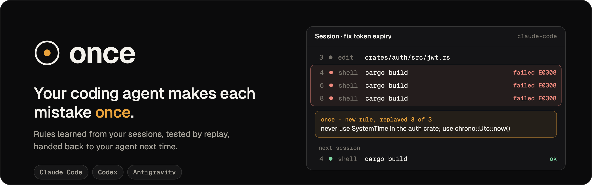
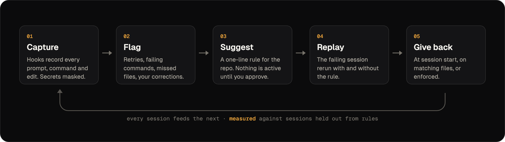
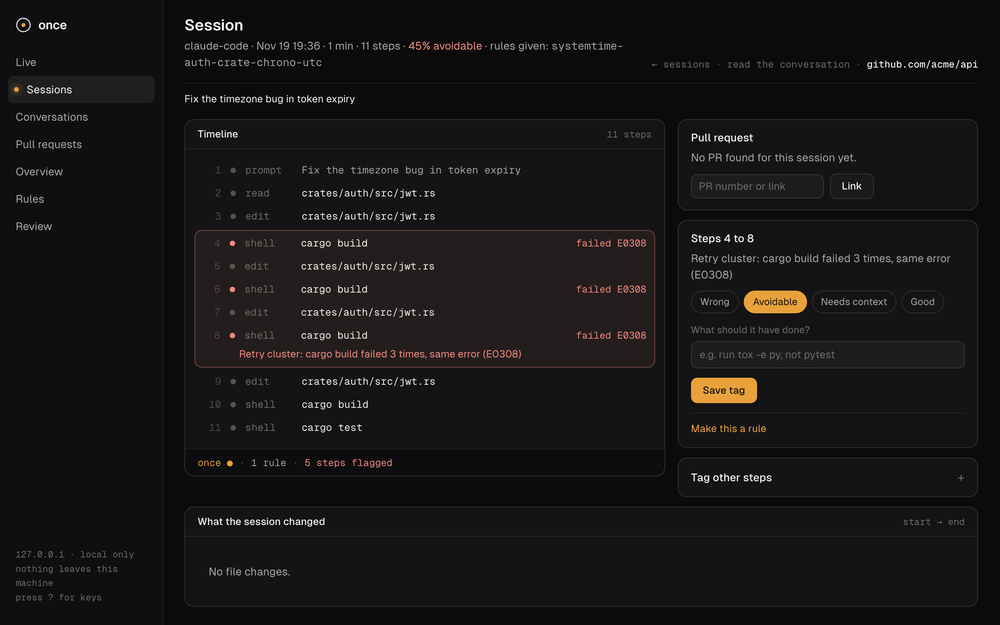
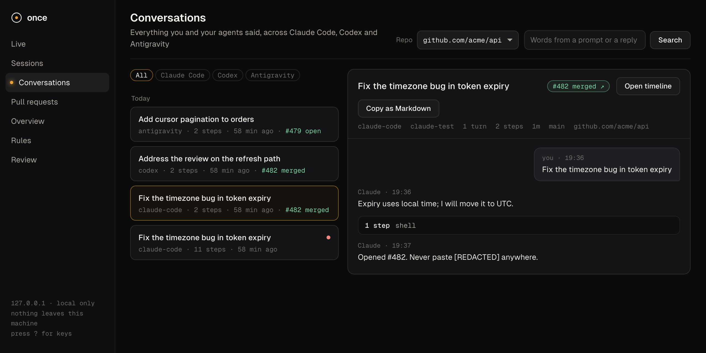
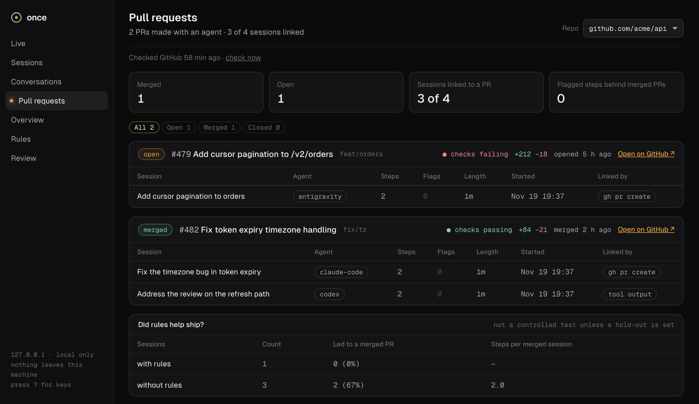

<p align="center">
  <picture>
    <source media="(prefers-color-scheme: light)" srcset="docs/img/banner-light.png">
    
  </picture>
</p>

<p align="center">
  <a href="https://pypi.org/project/once-cli/"></a>
  <a href="https://pypi.org/project/once-cli/"></a>
  <a href="https://github.com/Tanay0510/once/actions/workflows/ci.yml"></a>
  <a href="LICENSE"></a>
  
</p>

<p align="center">
  <a href="#install">Install</a> ·
  <a href="#how-it-works">How it works</a> ·
  <a href="#see-it">See it</a> ·
  <a href="docs/guide.md">Guide</a> ·
  <a href="CHANGELOG.md">Changelog</a>
</p>

---

Coding agents forget. The same build error three times, the same wrong test command, the same file missed,
session after session, even after you've corrected them.

**once watches your agent's sessions and turns each mistake into a rule for the repository.** It checks the rule by
replaying the session with and without it, and hands it back to the agent next time. It works with **Claude Code**,
**Codex** and **Antigravity**, and everything stays on your machine.

## Install

```bash
uv tool install once-cli    # or: pipx install once-cli  (the command is `once`)
once demo                   # the whole loop on a toy repo, in seconds; touches nothing of yours
```

Then, in a git repo you use with an agent:

```bash
once init                   # shows what it will change, then connects every agent it finds
```

That's the setup. Keep working as usual. Python 3.10 or newer, macOS or Linux.

> **Codex:** it runs new hooks only after you trust them. Start `codex`, type `/hooks`, and trust the ones that run
> `once.hook codex`.

## How it works

<p align="center">
  <picture>
    <source media="(prefers-color-scheme: light)" srcset="docs/img/how-it-works-light.png">
    
  </picture>
</p>

1. **Capture.** Each agent's hooks record prompts, commands and edits. Secrets are masked before anything is written.
2. **Flag.** once marks the steps that wasted time: the same error repeated, a command that keeps failing, a file
   read over and over, a file the agent should have changed. It also picks up corrections you type in the chat:
   *"no, use tox, not pytest"*.
3. **Suggest.** Each one becomes a one-line rule for the repo, optionally limited to some paths. Nothing is active
   until you say yes, in the chat, in the terminal, or in the dashboard.
4. **Replay.** `once lab replay` reruns the session that went wrong, three times without the rule and three times
   with it, in throwaway copies of the repo. A rule that doesn't change the outcome is marked as such.
5. **Give back.** Rules reach the agent at session start, and when it touches matching files. A rule can also be
   enforced:
   - a reminder after an edit that breaks it;
   - an error the agent must fix;
   - a refusal before the edit lands.

## See it

`once ui` opens a local dashboard. Nothing is hosted.

<table>
  <tr>
    <td width="50%"></td>
    <td width="50%"></td>
  </tr>
  <tr>
    <td><b>Sessions.</b> Every step of every session. Wasted steps are boxed in red. Tag them, or turn one into a rule in a click.</td>
    <td><b>Conversations.</b> What you and each agent said, in one searchable place, with flags and corrections pinned where they happened.</td>
  </tr>
  <tr>
    <td colspan="2"></td>
  </tr>
  <tr>
    <td colspan="2"><b>Pull requests.</b> The PRs your agents worked on, the sessions behind each one, and how each was linked. Also: whether sessions given rules ship more often than sessions without.</td>
  </tr>
</table>

## Day to day, without commands

- **Correct your agent** as you normally would. once keeps the correction as a suggested rule.
- **Answer it** when, at the start of the next session, the agent asks whether to keep a suggestion.
- **Glance at the status line** in Claude Code: `once ● 2 of 5 rules in use · 1 to review · 2 flagged`.
- **Read the weekly digest**, by file, notification, Slack or email.

When you want more: `once last` shows the last session, `once teach "..."` adds a rule, `once why` says which rules
apply and why, and `once review` goes through suggestions.

## Works with

|  | Claude Code | Codex | Antigravity |
| --- | :---: | :---: | :---: |
| Sessions recorded | ✓ | ✓ | ✓ |
| Rules at session start | ✓ | ✓ | ✓ (each turn) |
| Rules for matching files | native rule files | before commands | glob rule files |
| Enforcement | ✓ | ✓ | ✓ |
| Conversations and PR links | ✓ | ✓ | ✓ |
| Tools the agent can call (MCP) | ✓ | ✓ | ✓ |

## For teams

- **`once share`** opens a pull request that adds your rules to `.once/rules/`. Everyone using once in the repo
  gets them when it merges.
- **The collector** is one small server that gives a team one view: each agent and developer, where agents
  struggle, and which rules are broken where. It receives counts and outcomes only.
- **`once pr-check`** flags files a pull request probably missed, from the repo's own history. As a GitHub Action:

  ```yaml
  - uses: actions/checkout@v4
    with: { fetch-depth: 0 }
  - uses: Tanay0510/once@v0.9.0
  ```

## Privacy

- **Local by default.** Sessions, rules and the dashboard stay on your machine. The dashboard listens only on
  `127.0.0.1`.
- **Secrets masked** before anything reaches disk.
- **The collector is opt-in.** It never receives prompts, replies, code, commands or error text.
  `once collector push --dry-run` shows exactly what it would send.
- **Easy to leave.** `once purge` deletes sessions. `once uninstall` removes every hook and restores your settings
  exactly.

once never gets in your agent's way: if anything inside it fails, the agent carries on and the error goes to a log.

## Status

**Beta.** Seen working live:
- Claude Code and Antigravity: recording, rules, enforcement and the MCP tools.
- Codex: recording and conversations.

Still being proven: Codex enforcement, the learning loop at scale, and a measured improvement on held-out tasks.
The [changelog](CHANGELOG.md) keeps an honest list.

## Learn more

- **[The guide](docs/guide.md):** every feature and setting.
- **[Changelog and details](CHANGELOG.md):** release history and
  known gaps.
- **[AGENTS.md](AGENTS.md):** how the code is laid out, for people
  and agents working on it.

## License

[Business Source License 1.1](LICENSE).

- **Free to use, including at work and on commercial code:** with your own agents, on your own or your employer's
  repositories, and for your team.
- **Not allowed:** using it in a product or service you sell that competes with once.
- **Each version becomes Apache-2.0** four years after it is published.

For other terms, contact the author.
