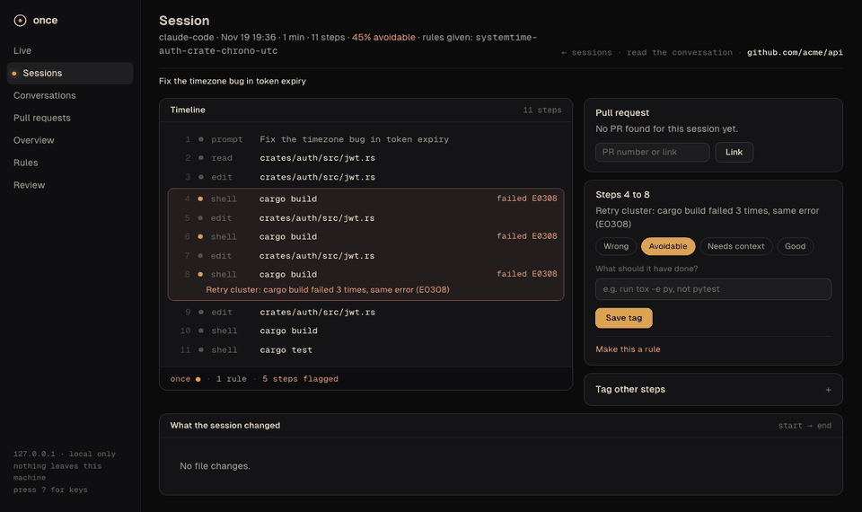
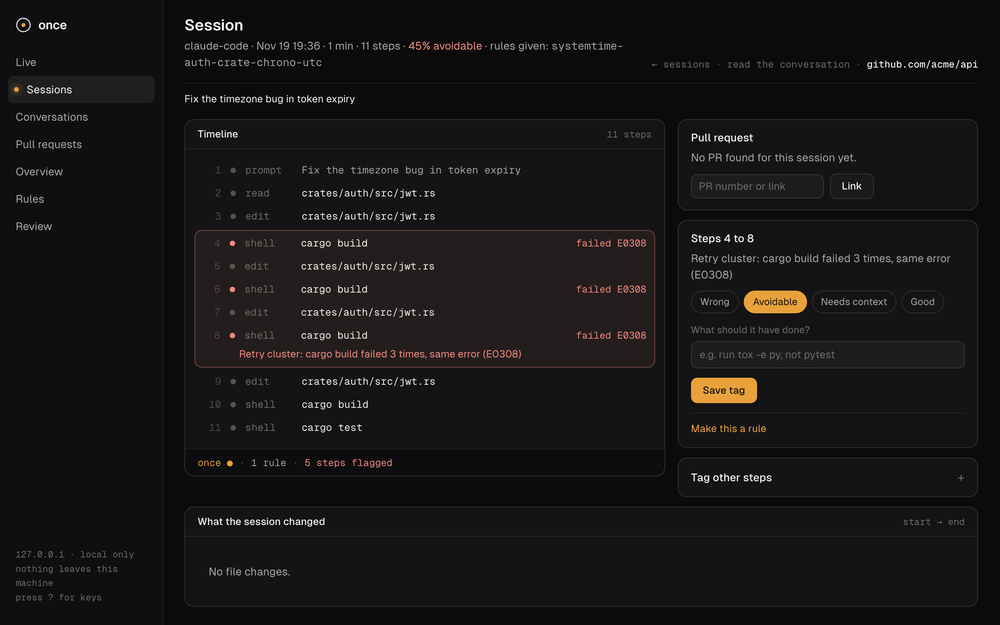
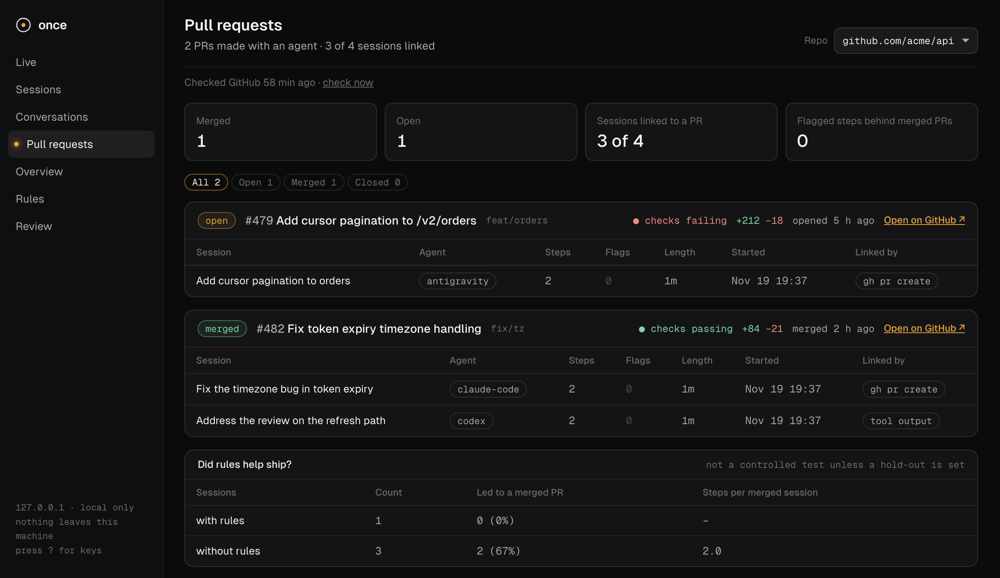
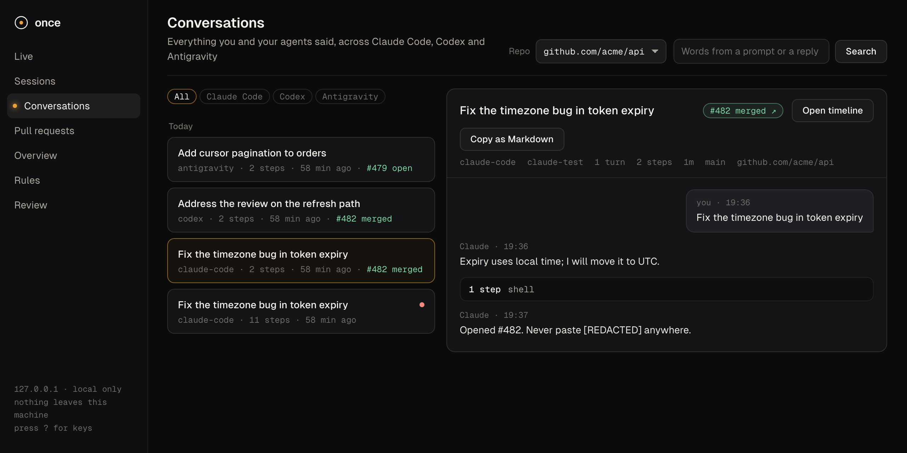

# once: the guide

once watches the sessions you run with Claude Code, Codex and Antigravity. It notices where the agent wasted steps
or was corrected, turns that into rules for the repository, checks each rule by replaying the session with and
without it, and gives the rules that work back to your agent at the start of the next session. Everything stays
on your machine unless you connect a team collector.



- [Install](#install)
- [Day to day](#day-to-day)
- [The dashboard](#the-dashboard)
- [Rules](#rules)
- [Pull requests and conversations](#pull-requests-and-conversations)
- [Your agents](#your-agents)
- [Measuring whether rules help](#measuring-whether-rules-help)
- [Teams](#teams)
- [Privacy](#privacy)
- [Settings](#settings)
- [When something looks wrong](#when-something-looks-wrong)
- [Leaving](#leaving)

## Install

```bash
uv tool install .          # from a checkout; or: pipx install .
cd <a git repo you use with an agent>
once init                  # shows what it will change, then installs on one confirmation
once demo                  # optional: the whole loop on a toy repo, touching nothing of yours
```

`once init` finds Claude Code, Codex and Antigravity on your PATH and connects each one it finds. Codex needs one
manual step: start `codex`, type `/hooks` and trust the hooks that run `once.hook codex`. `once doctor` checks
the whole setup and `once doctor --fix` repairs what it can.

## Day to day

You don't need to type any once commands day to day.

- **Correct your agent in the chat.** "No, use tox, not pytest" becomes a suggested rule.
- **Answer in the chat.** At the start of the next session the agent asks you about up to two suggestions.
- **Glance at the status line** at the bottom of Claude Code: rules in use, suggestions waiting, steps flagged.
- **Read the weekly digest**: a file in `~/.once/digests/`, a notification, and Slack or email if you set them up.

When you want to look closer:

| Command | What it does |
| --- | --- |
| `once` | status and the one next step |
| `once last` | the last session as a timeline, wasted steps marked |
| `once tag 4-8 avoidable "what it should have done"` | tag steps; the strongest signal once learns from |
| `once teach "always run the formatter"` | add a rule now |
| `once why [file]` | which rules apply, and why |
| `once ui` | the dashboard in your browser |
| `once off` / `once on` | pause and resume; `--session` for this session only |

## The dashboard

`once ui` opens a local page on `127.0.0.1:4317`. Pick a repo from the dropdown at the top right of any page.

- **Live**: the session running now, updated as it happens.
- **Sessions**: every session as a timeline. Wasted steps are boxed in red; click any step for the full command
  and error. Tag steps, turn a flagged step into a rule, and see what the session changed.
- **Conversations**: what you and the agent said. See below.
- **Pull requests**: which sessions led to which pull request. See below.
- **Overview**: trends over the last 30 days, compared with the 30 before; where agents struggle; each agent's numbers.
- **Rules** and **Review**: every rule, how often it was given and ignored, whether it worked; suggestions
  waiting for your yes or no.

Keys: `j`/`k` to move, `Enter` to open, `1` to `7` for the pages, `w a m g` to tag, `?` for the list.



## Rules

A rule is one sentence, optionally limited to some paths, kept as YAML in `~/.once/memory/` (a git repo you own).

- **Where rules come from**: your corrections in chat, tags, repeated failures, files the agent missed, review
  comments on merged pull requests, and your CI and lint config (`once lab bootstrap`, no model needed).
- **Nothing is active until you accept it** (`once review`, in the chat, or on the Review page).
- **Scope**: a rule can belong to the repo, or to you, one agent, a toolchain or an organization, and is
  inherited by every repo below (`once teach --level user ...`).
- **Enforcement**: `instruct` (context, the default), `remind` (shown after an edit that breaks it), `check`
  (the edit comes back to the agent as an error), `block` (refused before it lands). Raising a rule above
  `instruct` needs a detector (`once rules detect <id> "<regex>"`); `check` and `block` also need the agent to
  have ignored the rule first. `once rules promote <id>` does it.
- **Testing**: `once lab replay <id>` runs the session that went wrong with and without the rule, three times
  each, in throwaway copies of the repo. It asks first because it spends money.

## Pull requests and conversations



**Pull requests** lists each PR your agents worked on, with the sessions behind it. A session is linked to a PR
in one of these ways, strongest first, and the page says which:

1. **by hand**: you linked it on the session page;
2. **gh pr create**: the agent created the PR and its output printed the link;
3. **branch**: the session worked on the PR's branch (committed or pushed there, or switched to it), not merely
   ran while it was checked out;
4. **commit**: a commit made during the session is in the PR;
5. **tool output**: the agent printed a link to the PR some other way.

Titles, state and checks come from GitHub's `gh` command when it is installed and signed in. The answer is kept
for five minutes and refreshed in the background; if GitHub refuses, the page says why. The **Did rules help
ship?** box compares sessions that were given rules with sessions that were not. It is only a fair comparison
when `holdout_fraction` is set (see [Measuring](#measuring-whether-rules-help)).



**Conversations** shows your prompts and the agent's replies for every session, from all three agents in one
place. Tool steps are folded into one line per run; failed and flagged steps open by themselves; your corrections
are marked, with the rule each became. Search covers prompts and replies. Replies are read from each agent's own
transcript when you open a conversation. once does not copy them, and secrets are masked before they are shown.
**Copy as Markdown** puts the whole exchange on the clipboard.

## Your agents

| | Claude Code | Codex | Antigravity |
| --- | --- | --- | --- |
| Sessions recorded | yes | yes, after you trust the hooks | yes |
| Rules at session start | yes | yes | yes, each turn |
| Path rules | native rule files | before shell commands | glob rule files |
| Enforcement | all four levels | all four | all four; findings arrive next turn |
| MCP tools and skills | yes | yes | yes |
| Replies in Conversations | yes | yes | yes |
| PR links from output | yes | yes | yes, read from its transcript |
| Lab runs | yes | yes, no cost reported | yes, allow its commands first |

Antigravity in headless mode (lab runs and replays) refuses shell commands it cannot ask you about. Allow what the
tasks need in its settings, for example `{"permissions": {"allow": ["command(pytest)", "command(make)"]}}`.

## Measuring whether rules help

- `once config holdout_fraction 0.1` gives one session in ten no rules, so the rest can be compared with them.
- `once lab tasks mine` and `validate` turn merged pull requests into tasks with a check that fails before the fix.
- `once lab exp run --arms bare,rules,generated --repeats 3 --max-cost 20` runs an experiment; `once lab exp
  report` gives the verified rate per arm with intervals and cost per verified task. Arms: `bare`, `rules`,
  `generated` (the agent's own instruction file), `native` (its built-in memory), `unreviewed` (rules plus every
  suggestion still waiting: is review worth it?) and `rules+native` (do they add up?).
- `once lab regress` reruns every rule's replay and sorts rules into needed, obsolete, broken or harmful.
- `once lab cost` shows tokens, overhead and break-even per rule.

## Teams

- `once share` opens a pull request that adds your rules to `.once/rules/` in the repo. Everyone who uses once
  there gets them when it merges.
- **The collector** gives a team one view. Someone runs `once collector serve` (or the `once-collector`
  container); each developer runs `once collector connect <url> --token <t>`. After each session a summary is
  sent in the background. The team page shows each agent and each developer, where agents struggle, rules across
  the team, how suggestions fare, how many sessions led to a merged PR, and whether rules help ship.
- `once collector push --dry-run` prints exactly what would be sent.
- **Pull request check in CI.** `once pr-check <number>` lists files a pull request probably missed (files that
  usually change together with the ones it touches, from the repo's history) and the rules for the files it
  touches, including rules committed to `.once/rules/`. As a GitHub Action:

  ```yaml
  on: pull_request
  permissions: {contents: read, pull-requests: write}
  jobs:
    once:
      runs-on: ubuntu-latest
      steps:
        - uses: actions/checkout@v4
          with: {fetch-depth: 0}          # it reads history
        - uses: Tanay0510/once@v0.8.1     # comments only when it finds something; one comment, updated
  ```

  While the once repository is private, other repositories cannot use the action; it runs on once's own pull
  requests (`.github/workflows/pr-check.yml`).

## Privacy

- Secrets are masked before anything is written to disk.
- Sessions, rules and the dashboard stay on your machine. The dashboard only answers on `127.0.0.1`.
- The collector, if you connect one, receives:
  - counts, flags by kind, and the folders flagged steps touched;
  - rule ids and wording, and outcomes;
  - the number, state and link kind of each session's PR.

  It never receives prompts, replies, commands, error text, file contents, paths below the folder, or PR links.
- `once purge` deletes captured sessions; `once purge --older-than 30` keeps the last month.

## Settings

`once config` lists them all. The ones people change:

| Setting | Meaning |
| --- | --- |
| `teach_by_talking` | turn chat corrections into suggestions (default on) |
| `ask_in_agent` | the agent asks you about suggestions (default on) |
| `auto_learn`, `daily_cost_cap` | draft suggestions after each session, within a daily budget |
| `holdout_fraction` | share of sessions given no rules, for measurement |
| `snapshots` | record what each session changed (default on) |
| `digest`, `slack_webhook` | the weekly digest, and Slack delivery |
| `digest_email`, `smtp_host`, `smtp_port`, `smtp_user`, `smtp_password_cmd` | email delivery of the digest |

The mail password is never stored in once's settings. Set `ONCE_SMTP_PASSWORD`, or point `smtp_password_cmd` at
something that prints it, such as `security find-generic-password -s once-smtp -w` on macOS.

## When something looks wrong

- `once doctor` checks hooks, MCP, rule files and the index; `--fix` repairs.
- `ONCE_DEBUG_PAYLOADS=/tmp/payloads.jsonl` records every raw hook payload, secrets masked: the quickest way to
  see whether an agent update renamed something.
- CLI errors print one line; details go to `~/.once/local/cli-errors.log`. `ONCE_DEBUG=1` shows them in full.
- Hooks never stop your agent: any error is logged to `~/.once/local/hook-errors.log` and the agent carries on.
- The index database is only a view of the session files. A damaged one is set aside and rebuilt by itself.

## Leaving

`once off` pauses. `once undo` reverses the last teach, drop, tag or promotion. `once uninstall` removes the hooks,
MCP servers and generated files, and restores your settings exactly; your rules stay in `~/.once/memory/`.
`ONCE_DISABLE=1` makes every hook do nothing.
